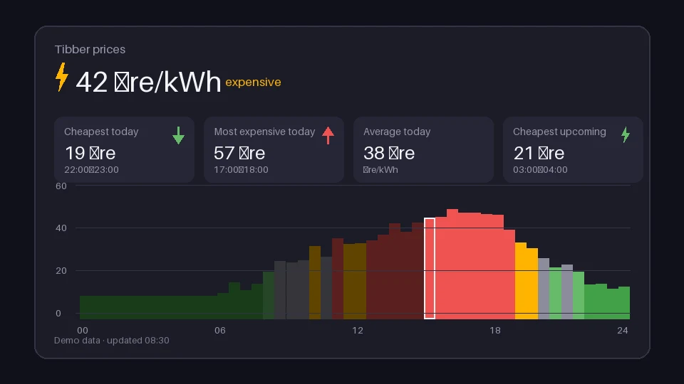

# Tibber



**Tibber** is a [Noctalia](https://docs.noctalia.dev) (v5) plugin that shows **Tibber electricity prices** in your shell, visually modeled after [duxtibber](https://github.com/antonjah/duxtibber). It runs on Tibber's public **demo data** (the demo token from the [API explorer](https://developer.tibber.com)), so it works out of the box — no account, no token.

## Features

- **Bar widget** — the current price right in your bar, colored by Tibber's price level (green = cheap … red = very expensive), with a tooltip showing the current slot. Click it to open the panel.
- **Panel** — current price and level on top, stat tiles for the **cheapest and most expensive time of the day** (plus the daily average and the cheapest slot still ahead), and a bar chart of today's and tomorrow's prices: price axis, hour labels, day filter, dimmed past hours, a divider between the days, and hover details (time, price, level) per bar.
- **Desktop widget** — a compact tile for the desktop with the current price, a sparkline of the day's prices, and the min/max of the day.
- One headless **service** polls the API and shares the parsed model with all widgets through the plugin's state channel, so every surface stays in sync.

## Install & usage

```sh
noctalia msg plugins source add neoscaler git https://github.com/neoscaler/noctalia-plugins
noctalia msg plugins enable neoscaler/tibber
```

- Bar widget: bar's Add-widget picker → type `neoscaler/tibber:bar`
- Desktop widget: desktop-widgets editor → type `neoscaler/tibber:desktop`
- Panel: click the bar widget, or `noctalia msg panel-toggle neoscaler/tibber:panel`

## Settings

| Setting | Default | Description |
| --- | --- | --- |
| `refresh_minutes` | `15` | Refetch interval (5 / 15 / 30 / 60). Failed requests retry after 60 s. |
| `price_unit` | `minor` | `minor` = ct/kWh (EUR), öre/kWh (SEK) etc.; `major` = EUR/kWh, SEK/kWh. |
| `show_unit` | `true` | Append the unit to prices. |
| Bar widget `glyph` | `bolt` | Glyph next to the price in the bar. |
| Desktop widget `color`, `show_chart`, `show_minmax` | `primary`, `true`, `true` | Sparkline color and which parts the tile shows. |

## Data & privacy

- The only network call is a GraphQL POST to `https://api.tibber.com/v1-beta/gql` with Tibber's public demo token (`3A77EE…AD7BE1-1`, from the API explorer). It returns auto-generated demo data only; no personal data is read or sent, and requests honor `shell.offline_mode`.
- Prices are quarter-hourly slots for today and (once published, usually after 13:00) tomorrow. The currency comes from the API (SEK in the explorer's demo home) and is shown with a matching unit.
- Price levels follow Tibber's definition relative to the day's average (very cheap / cheap / normal / expensive / very expensive) and are mapped to green / amber / the palette's error color, as in duxtibber.

## Files

```
tibber/
├── plugin.toml            # manifest: settings + service/widget/panel/desktop_widget entries
├── model.luau             # query, parsing, stats, formatting (ported from duxtibber's Tibber.js)
├── service.luau           # polls the API, publishes noctalia.state
├── widget.luau            # bar widget
├── panel.luau             # price panel (chart + min/max tiles)
├── desktop.luau           # desktop widget
├── thumbnail.webp         # 960x540 store preview
└── translations/          # en, de
```
